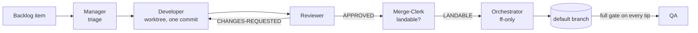

# spec-driven-delivery-team

An autonomous, docs-driven software delivery team that runs on **any coding
CLI**. You file backlog items as files in your repo; an orchestrator runs a
team of roles — Developers, a Reviewer, a Merge-Clerk, QA — as headless
processes of whatever engine you configure (Claude Code and the Antigravity
CLI tested; Codex, Gemini and others best-effort), each in its own git
worktree, reviewing each
other's work and landing fast-forward-only commits. It has produced thousands
of commits end-to-end, under human direction but not human keystrokes.

## The idea: docs are the spec

The framework's central bet is that **documentation is the specification** and
everything else follows from it:

- Where a project declares docs-as-spec, a doc-vs-code mismatch means the
  *code* is wrong. Roles may sharpen a doc, but never re-decide one —
  decisions belong to the owner.
- A change that alters behaviour ships its spec edit **in the same commit**;
  a missing spec edit is a review defect, exactly like a missing test.
- The spec is **audited**: the `consistency-check` role checks the docs
  against themselves, then the code against the docs, filing every confirmed
  delta as a backlog item.

The backlog itself follows the same principle — one file per item, priority in
the filename, deleted by the commit that lands the work. All work state lives
in git, not in anyone's memory.

## The team

Five roles, each deliberately narrow, plus the orchestrator that runs them:

| Role | Does | Never |
|---|---|---|
| **Orchestrator** (`sdt`) | Creates worktrees, dispatches, batches reviews, lands, runs the full gate, files what roles return | Pushes, or writes a line of code |
| **Manager** | Triages the backlog and rules on what the pipeline cannot route | Implements anything |
| **Developer** | One item, own worktree, one commit | Merges |
| **Reviewer** | Judges the change and independently re-verifies it | Writes — verdicts only |
| **Merge-Clerk** | Judges landability, rebasing a trivially-behind branch with a range-diff proof | Re-reviews — the Reviewer already did |
| **QA** | Root-causes a new full-gate failure on a landed tip | Fixes — it files items |

Not every change pays for that pipeline: at intake, small single-area work is
routed down a **direct lane** your own session handles, while risky work —
auth, data-model, cross-cutting, multi-phase — takes the **team lane** through
the full path:



Team-lane code lands only through the orchestrator's fast-forward of the sha
the Merge-Clerk verified; a direct-lane change is landed the same way —
fast-forward only — by the session that did the work, once it has passed the
scoped gate and a self-review. Either way history stays linear and every
commit traces to one verified change. And because state is branches,
worktrees, and backlog files, a role run that dies is simply re-dispatched and
reconstructs its world from git.

Owner-run specialists — `exploration` for feature-spike waves, `ui-inspector`
for visual QA — live in `roles/` beside the team and run through `sdt role`.

## Any harness, one execution path

Every role runs as **one headless, worktree-confined process** of the engine
the project names in its config; an adapter file per engine says how to run
that CLI (`adapters/claude.toml` and `agy.toml` have landed real runs;
`codex`, `gemini`, `cursor`, `opencode` and `copilot` ship best-effort and
say so). The orchestrator is the
only component that talks to an engine, so switching engines — or running
developers on one and judgment roles on another — is a config change. The
skills that let your harness session drive the team are plain `SKILL.md`
files, the format every current harness reads.

## Get started

Clone the framework, then in each project you want the team to work on:

```
sdt init                       # creates .delivery-team/config.toml and profile.md from the templates
sdt install --harness claude   # or codex | gemini | cursor | opencode | copilot | all
sdt doctor                     # engine on PATH, preconditions, roles
```

`bin/sdt` needs only `python3` 3.11+ and `git`; `sdt install --bin-dir
~/.local/bin` links it onto your PATH. Then:

1. Fill in `config.toml` (gate commands, backlog location, engine) and
   `profile.md` (whether your docs are the spec, invariant guards, content
   rules).
2. Create the backlog directory and file an item or two.
3. `sdt run`, or ask your harness to run the team — the `team` skill knows
   how. `sdt board` opens the live progress board; `sdt status` prints the
   run.

Claude Code users can install it as a plugin instead (the repo is its own
single-plugin marketplace), which also puts `sdt` on the Bash tool's PATH:

```
/plugin marketplace add dipeshc/spec-driven-delivery-team
/plugin install delivery-team@spec-driven-delivery-team
```

You'll need a git repo and a frontier-tier model for the judgment roles
(Manager, Reviewer, Merge-Clerk, QA) — developers run on the mid tier unless
triage raises them. You stay in the loop for owner decisions: anything a role
cannot decide is moved to `blocked/` with its reason.

## Going deeper

The details live in the docs, which are this repo's own specification — it
runs its own process on itself, backlog and all:

- [`docs/architecture.md`](docs/architecture.md) — what each component is and
  the nine invariants that bind them. The entry point.
- [`docs/team-charter.md`](docs/team-charter.md) — the shared rules every
  role obeys: lanes, role runs, writers, verification, message schemas.
- [`docs/config.template.toml`](docs/config.template.toml) and
  [`docs/profile.template.md`](docs/profile.template.md) — the per-project
  configuration: machine-read and prose halves.

Claude Code extras: `/delivery-team:statusline` installs a two-line terminal
statusline for team runs (it chains onto any statusline you already have and
stays silent outside team projects), and `/delivery-team:consistency-sweep`
runs the spec audit as a parallel workflow.

## License

MIT
